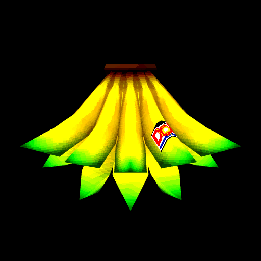

<p align="center"></p>

classic tool to boost your productivity x1000 - click activate, turn up your volume and just get to work my guy

**Live:** https://1hourofsilenceoccasionallybrokenupby.vercel.app

# hourbreak

A productivity app.

It is not a productivity app. It says `BOOST X1000`, shows a big pixelated banana bunch that
you can kickflip by clicking it, asks you to activate it and leave the tab running — and then
plays one completely random noise every 30+ minutes for as long as you leave it open. No
visitor-facing copy ever admits what it does.

## Run it

```sh
python3 -m http.server 8080
open http://localhost:8080
```

No build step. `index.html`, `style.css`, `app.js`, `banana.js`, `stars.js`,
`vendor/three.js`, and six asset folders.

## The page

Four elements, in this order, and they never move:

1. the title, `BOOST X1000`
2. the banana bunch, big, rotating, clickable
3. one red underlined `activate` link (becomes `🔊 deactivate` while running)
4. the subtext — *leave me running and just do your thing my guy! feel your productivity go up
   instantly!*

The subtext occupies its space even when it is invisible, and the button is a full-width flex
box, so activating changes nothing about the layout. Activating only does three things: the
banana spins ~8× faster, the starfield appears, and the noises start.

There is no timer, no status line, no counter, no options.

## The banana

A Super Monkey Ball banana bunch, 240 triangles, from the GameCube item rips. It is rendered at
one third resolution with nearest-filtered textures and a contrast/saturation boost applied to
the textures at load, so it reads as a chunky PS1-era sprite. It spins on the vertical axis
only.

Click it and it does a kickflip: a 360° flip around the horizontal axis with a small hop, 0.62 s,
eased. Land a second click inside the 620 ms window after it lands and the combo goes up.
Multiplier labels run x1, x2, x5, x10, x25, x50, x100, x250, x500, x1000. Every combo hit plays
a Tony Hawk trick sound, banded by combo count:

| combo | sound |
|---|---|
| 1–5 | `special-trick` |
| 6–10 | `combo-1` |
| 11–15 | `combo-2` |
| 16–20 | `combo-3` |
| … | `combo-4` … `combo-7` |

```sh
bash scripts/build-banana.sh                 # default model, reads HB_BANANA_ZIP
bash scripts/fetch-tricks.sh                 # 8 trick sounds from myinstants
```

`build-banana.sh` extracts `OBJ_BANANA_02_LOD100` (the bunch — `OBJ_BANANA_01_*` is the single
banana) from the Super Monkey Ball items zip, and converts OBJ+MTL+PNG to a single GLB with
embedded textures via `obj2gltf`. `favicon.png` is a 512×512 render of that same model.

## The starfield

While a session is running, a transparent canvas above the background draws 150 white stars
flying outward from the centre, rendered at half resolution so they upscale into chunky squares
— the Windows starfield screensaver, on top of the photo. It stops and clears when you
deactivate.

## The backdrops

15 YouTube thumbnails from the `1 hour of silence broken by` search. The starting image is
picked at random on every load, and a new one is picked at random every 30 s, never repeating
the current one. No fade — the image is swapped in a single frame.

```sh
bash scripts/fetch-thumbs.sh                     # default query, 15 results
bash scripts/fetch-thumbs.sh "some query" 20
```

## The noises

42 clips, 32 kHz mono. `scripts/sounds.tsv` is the source of truth: `slug`, `youtube id`,
on-screen label, max seconds.

```sh
bash scripts/fetch-sounds.sh          # skips clips that already exist
bash scripts/fetch-sounds.sh --force
```

Pipes YouTube audio straight into ffmpeg, which strips leading silence, trims, fades, normalizes
to −15 LUFS, hard-limits at −1 dBFS, and writes `sounds/<slug>.mp3`. Reports RMS and peak per
clip, regenerates the manifest, retries failures three times. To add one: append a row, run the
script, reload.

### Signals

The gap between noises never falls below **30 minutes**:

| bucket | weight | range |
|---|---|---|
| normal | 55% | 30m – 45m |
| long | 30% | 45m – 80m |
| very long | 15% | 80m – 150m |

Skewed toward the low end with `Math.pow(random, 1.9)`. Measured over 200k draws: min 30.0m,
median 42.5m, p95 112.7m, zero gaps under 30m.

The **first** signal is 5–8 minutes after you activate, so it does not fire while you are still
looking at the page. There is a 9% chance of a double 0.4–1.1 s after the previous one, and no
clip repeats within its last three plays.

A session runs for one hour and then quietly stops: the banana slows, the starfield clears and
the noises end. Nothing on the page says so.

## three.js

`vendor/three.js` is a minified esbuild bundle of three.js plus `GLTFLoader`, tree-shaken down
to only what the banana layer uses (600 KB raw, **151 KB gzipped**).

```sh
bash scripts/vendor-three.sh
```

Installs `three` + `esbuild` into a temp dir, bundles `scripts/three-entry.js`, writes
`vendor/three.js` and the version in `vendor/three.version`. No `node_modules` in the project.

## Assets

| folder | size | what |
|---|---|---|
| `sounds/` | 1.5 MB | 42 noises |
| `tricks/` | 292 KB | 8 Tony Hawk trick sounds |
| `thumbs/` | 376 KB | 15 background photos |
| `vendor/` | 608 KB | three.js bundle (151 KB gzipped) |
| `banana/` | 24 KB | the banana bunch GLB |
| `fonts/` | 16 KB | Silkscreen (now unused, kept for reference) |
| `favicon.png` | 36 KB | 512×512 render of the banana |

## Deploy

Static. `vercel.json` sets long cache headers on the asset folders.

```sh
vercel deploy
```
